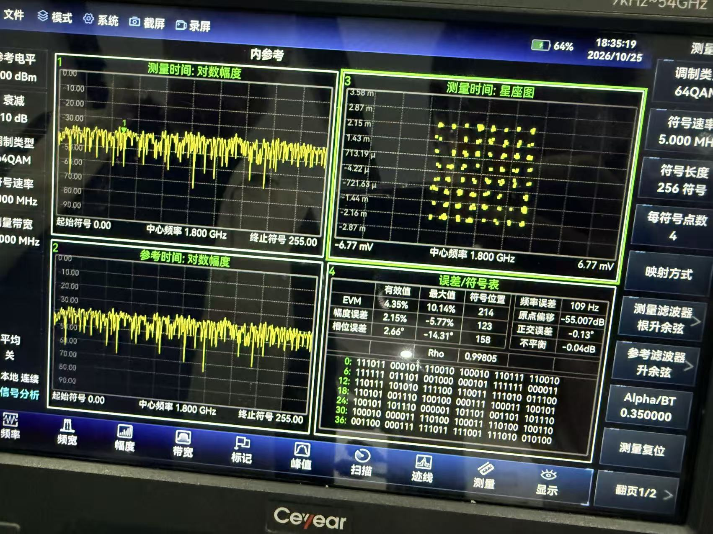
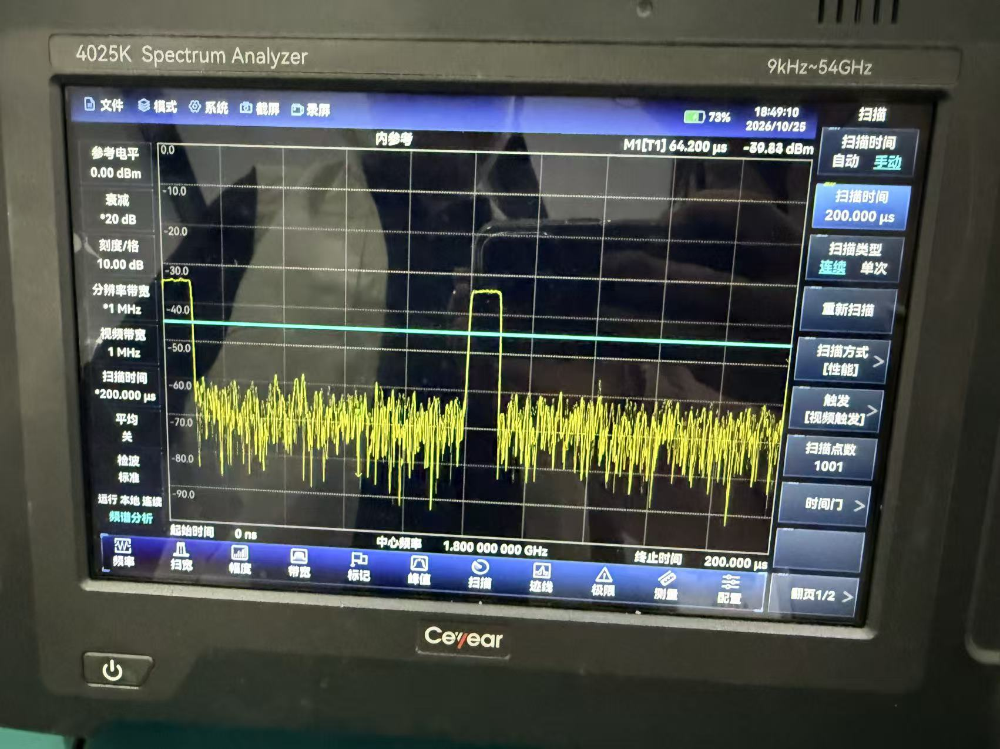
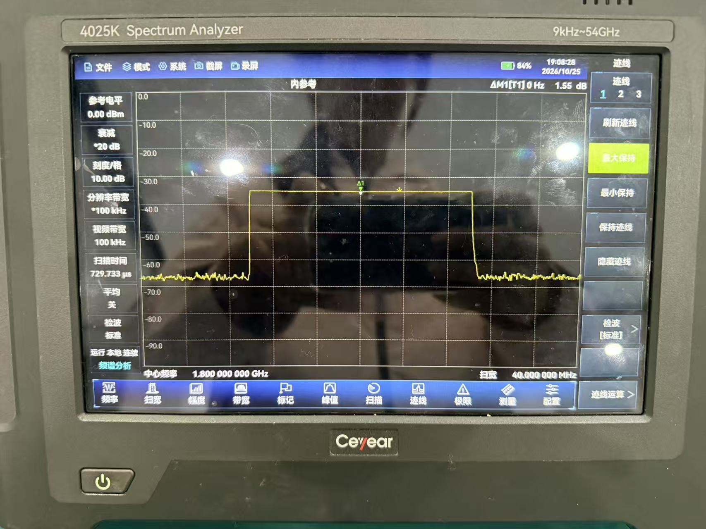
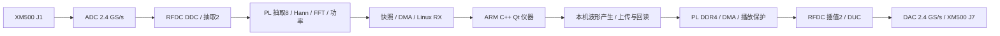

# 信号处理及产生综合平台 · ZCU111 V17 源码版

一套独立运行在 AMD RFSoC ZCU111 上的可编程矢量信号源与频谱分析系统，集信号产生、采集、频谱分析与交互显示于一体。平台把高速 ADC/DAC、FPGA 并行信号处理、**ARM PetaLinux/Linux、Weston桌面会话与原生C++17/Qt5 Widgets仪器界面**集成在同一块板卡上，面向信号处理教学、通信波形验证和射频实验。连接 DP 显示器与 USB 鼠标即可操作，无需上位机参与日常采集、波形生成和播放控制。

本仓库当前生产源码入口为 **V17 / 应用0.11.0 / narrow09硬件基线**，源码发布于2026-11-03，说明复核于2026-11-04。V17将CW功率模型设置推广到1300–2300 MHz，非1790 MHz频点明确标为ESTIMATED，原功率范围不变。**V17已由队友完成上板验证并通过，按用户2026-11-03确认记录；本仓库提供当前源码与复现入口。** FPGA、RFDC、内核驱动与接口保持原基线。仓库提供源码、配置、构建脚本和可核查的测试证据，Vivado 工程与运行文件按步骤重新生成。

## 设计亮点

- **从高速数据到仪器操作的完整链路。** 单路 ADC/DAC 均配置为 2.4 GS/s；PL 完成抽取、Hann 加窗、FFT 与功率运算，再将结果送给 ARM。界面直接支持调谐、RBW选择、视频平均、扫描时间、峰值搜索和 Marker 比较。
- **软硬件各取所长。** 高频率、重复性强的运算放在 FPGA，波形生成、数据管理、扫描拼接、标定模型和交互放在 ARM。接收复采样率为 150 MS/s，65536 点频谱包仅 524544 字节，降低 CPU 数据搬运与显示负担。
- **频段覆盖与细节分析兼顾。** NCO 调谐和重叠分段拼接实现 1.3–2.3 GHz 的 1 GHz 扫描视图；局部分析支持 1024、8192、65536 点 FFT。65536 点时频率格间隔约 2.289 kHz、Hann 等效噪声带宽约 3.433 kHz。
- **可编程 I/Q 矢量波形和可验证的播放链路。** ARM 本机生成 CW、脉冲、LFM、脉冲 LFM、Barker13、PSK、QAM；10 ms 波形以 48 MB I/Q 文件上传到 PL DDR4，回读及 SHA256 验证后播放，配套停止、静音和欠载保护。播放链路以兼容格式的 I/Q 文件为输入，可用自定义 I/Q 描述 FSK、AM/FM 等其他波形；FSK 当前没有内置界面预设，扩展波形仍需数字及射频验证。
- **从一次实现走向可复用工程。** 功率模型保留参考面、原始读数与独立检查点；构建、启动配套接口契约和哈希回执；附带可独立使用的 FPGA 证据工作流技能包。

## 多调制矢量输出：已有外部仪器观察

统一I/Q播放链路构成**可编程任意I/Q矢量信号源**，可表达QAM、PSK、LFM、FSK、脉冲、相位编码等调制。QAM、PSK、LFM、脉冲等已有C++内置生成预设；FSK及其他调制可定义并导入兼容I/Q波形，并附有开发电脑上的历史CPFSK2离线生成参考。任意波形受采样率、记录长度、通带与峰值约束，各类型验证状态见[平台能力与实现](docs/platform_overview.md)。

| 64QAM星座 | 脉冲RF包络 | LFM最大保持频谱 |
|---|---|---|
|  |  |  |
| 1.8 GHz、5 MSym/s、α0.35；256符号窗口 | 200 µs时窗；10 µs/100 µs为波形设定 | 40 MHz显示跨度；配有实测I/Q频率随时间分析 |

这些是2026-10-25的历史外部硬件测量，展示平台矢量播放能力；当前C++版本的逐型RF验收另记。完整原图、测量条件、LFM分析图及照片使用建议见[多调制实测图册](docs/waveform_gallery.md)。

## 正式参赛材料

- [设计报告 DOCX](report/51957_design_report_v17.docx)：V17版本说明、原理、接口、优化、实测、协作与复现，历史结果保留原版本。

报告保留原始高清图片，使用Git LFS保存；可在上方报告页面点击下载。通过Git克隆后，使用`git lfs pull --include="report/51957_design_report_v17.docx"`取得完整报告。源码文件不依赖Git LFS。打包前须取得完整报告，打包脚本会拒绝将LFS指针误当作报告收入提交包。
- [大模型协作记录 Markdown](report/llm_collaboration.md)：从报告第6章拆分的精选真实提问、回答及纠错轨迹，可单独提交；不等同全量聊天导出。

精选问答仅集中于以上两份材料；Skill和其他说明保留技术案例总结。

## 能力与实测摘要

| 项目 | V17源码功能 / 沿用的历史证据 |
|---|---|
| 独立操作 | ARM PetaLinux/Linux + Weston/Wayland桌面 + C++17/Qt5 Widgets；Spectrum / Generator，DP1080p、鼠标操作人工确认 |
| 接收处理 | ADC2.4 GS/s → RFDC抽取2 → PL抽取8 → 150 MS/s复数；Hann / FFT / 功率谱 / DMA |
| 连续频谱 | 持久打开RX设备、后台取帧、最新帧显示；N65536、平均1，V16记录82次显示/8.416 s，约9.74次/s |
| 频段扫描 | 1.3–2.3 GHz，13段NCO顺序扫描；N8192、平均1的两次历史端点测试每轮约2.65 s |
| Marker | 主页面M1–M4；峰值搜索、跟踪、点击定位、参考Marker及频率/幅度差值 |
| 物理量操作 | FFT等效RBW、线性功率平均与等效VBW、最小扫描停留时间；CW dBm/dBW模型 |
| 波形播放 | 本机产生10 ms波形，48 MB上传/回读/SHA256，显式RF PLAY / RF STOP；CW已有仪器读数，当前C++16QAM有实测频谱照片 |
| 资源与时序 | LUT72273 / Registers113196 / BRAM Tile602.5 / DSP183；WNS+0.140 ns、WHS+0.010 ns、WPWS+0.014 ns |

**面向1.3–2.3 GHz、1 GHz宽中频工作带设计；接收1 GHz视图由顺序扫描实现，150 MS/s是处理复采样率，扫描每段采用中心±50 MHz。发射为1.2 GS/s复I/Q矢量架构；当前2倍插值滤波规格推导的通带约960 MHz，尚未完成全1 GHz模拟平坦度验收。** 工作带选择、带通采样计算、滤波通带与扫描区别见[频率规划与带宽](docs/bandplan_and_bandwidth.md)。连续模式用于连续刷新频谱；当前未提供全带宽无间断原始 I/Q 录像。**1790 MHz 是 CW 功率模型的标定频点，不是 CW 唯一可发射频点。** V16 Generator 在 Digital peak 数字幅度模式下可设 RF 1300–2300 MHz；V17的CW model dBm/dBW同样接受1300–2300 MHz；1790 MHz使用参考模型，其他频点使用该模型的显式功率估算并显示ESTIMATED。功率范围仍由所选模型限定：4025G条件−40至−20 dBm，原FSVA条件−50至−10 dBm，不能当作全带绝对功率已标定。其他调制使用数字幅度模式，接收全频段谱线使用 dBFS/bin。频率端点及全带幅度平坦度尚需按发射条件复核。详细指标见 [硬件与性能](report/hardware_performance.md) 和 [实测比对](board/measurements.md)。

V17改动、构建/验证状态与回退方式见[V17源码交付说明](docs/v17_release.md)。更多波形、历史星座证据及后级变频扩展方案，见 [矢量信号源能力说明](report/vector_signal_source.md)。

## 嵌入式Linux仪器技术栈

**ARM Cortex-A53运行PetaLinux/Linux，内核驱动管理DMA与设备；Weston提供Wayland桌面会话、鼠标输入和DP显示；原生C++17/Qt5 Widgets提供仪器HMI。** 波形生成、标定与扫描拼接在ARM完成，高速FIR/FFT和播放数据流在FPGA完成。这是采用成熟嵌入式Linux/Qt技术路线的独立仪器，不需要上位机承担日常控制。源码、启动配置及职责划分见[平台架构与实现对应](docs/platform_overview.md)。

## 系统结构



**本平台先完成宽中频矢量产生与分析核心；在J7后接入本振、混频、滤波及必要的幅度控制模块，可扩展为覆盖目标射频工作频段的完整矢量信号源。**该方案尚未集成验收；实际覆盖范围由模块决定，变频不会自动增加瞬时调制带宽。

## 推荐目录与入口

| 目录 | 内容 | 阅读入口 |
|---|---|---|
| `docs/` | 平台卖点、嵌入式技术栈、频率规划与外部测量图册 | [说明索引](docs/README.md) |
| `src/` | RTL、BD Tcl、约束/系数/时钟；Qt、驱动、RFDC辅助程序；PetaLinux/SDT | [源码完整性](report/source_completeness.md) |
| `sim/` | Verilog测试平台、黄金参考、C++测试说明和原始结果 | [验证索引](sim/verification_catalog.md) |
| `build/` | 工程恢复、综合实现、Linux/SDK、SD包构建脚本；原始综合实现报告 | [完整复现](build/reproduce.md)、[构建入口](build/README.md) |
| `board/` | 启动/运行脚本、冻结回执、实板结果、验收流程 | [上板步骤](board/bringup.md)、[实测比对](board/measurements.md) |
| `data/` | 原始频谱包、参考读数、标定模型、比对表及测量照片 | [数据索引](data/README.md) |
| `skill/` | 工作流、真实故障案例、提示词、模板和校验工具 | [技能包](skill/README.md) |
| `report/` | 要求对照、源码审计、架构/性能、优化过程、材料清单及验证回执 | [当前提交清单](docs/v17_submission_checklist.md) |

## 从零复现

以下命令均在仓库根目录执行。Windows可将python3替换为python。建议短英文路径，例如C:/fpga/zcu111_v17。

### 1. 工具与完整性

- Vivado **2025.2**、RFSoC/ZCU111器件和板卡支持、有效器件综合实现许可。
- Linux编译机：PetaLinux **2025.2**及匹配SDK；已验收环境Qt5.15.13、GCC13.4、Linux6.12.40-xilinx。
- 开发电脑Python3.10+；数值参考依赖见sim/python/requirements.txt。板端不依赖Python/PYNQ。

```sh
python3 build/check_submission.py
python3 sim/replay_evidence.py
python3 sim/check_bandplan.py
```


### 2. 恢复并构建 FPGA

```sh
vivado -mode batch -source build/fpga/create_project.tcl -tclargs C:/fpga/v16_hw_new
```

在Vivado打开新目录下的zcu111_v16.xpr查看完整BD（工程名沿用narrow09硬件基线，V17是应用软件版本）。上述命令恢复并检查工程，完整综合/实现/BIT/XSA另执行：

```sh
vivado -mode batch -source build/fpga/build_bitstream.tcl -tclargs C:/fpga/v16_hw_new/zcu111_v16.xpr C:/fpga/v16_exports
```

Linux使用绝对Linux输出路径。选择新目录，采用新BIT前核对该轮时序和布线结果。

### 3. 跑仿真与参考测试

```powershell
powershell -NoProfile -ExecutionPolicy Bypass -File .\sim\run_rtl_tests.ps1 -VivadoBin 'D:/Vivado/2025.2/Vivado/bin' -OutputDir 'C:/fpga/v16_rtl_new'
```

```sh
python3 -m pip install -r sim/python/requirements.txt
python3 -m unittest discover -s sim/python -p 'test_*.py'
```

V17完整Linux/Qt构建入口包含12项CTest；本机非Qt路径7项通过，上板验证通过情况由队伍确认。测试对象、预期及原始日志见 [验证索引](sim/verification_catalog.md)。

### 4. 构建 PetaLinux / SDK / 板端软件

加载PetaLinux2025.2环境后执行：

```sh
bash build/linux/prepare_petalinux.sh /absolute/new_petalinux_project
```

在新工程中设置自己的网络、用户凭据，构建镜像与SDK。使用同轮准备好的内核目录：

```sh
export SDK_ENV=/absolute/sdk/environment-setup-cortexa72-cortexa53-amd-linux
export PLNX_PROJECT=/absolute/new_petalinux_project
export KERNEL_BUILD=/absolute/prepared_kernel_build_directory
bash build/linux/build_all.sh /absolute/v17_linux_output
```

KERNEL_BUILD须包含目标内核.config和Module.symvers。PetaLinux镜像/SDK构建、SDT导入、BOOT打包的完整命令在 [build/reproduce.md](build/reproduce.md) 第4–6节，按顺序执行。

### 5. 生成 SD 文件并启动

```sh
python3 build/make_sd_runtime.py --runtime /absolute/v17_linux_output/zcu111_instrument_qt5_20261103_17 --boot-bin /absolute/new_petalinux_project/images/linux/BOOT.BIN --output /absolute/v17_sd_files
```

将新运行包/start_v17.sh与同轮BOOT.BIN、image.ub、boot.scr放到SD第一FAT分区。板卡启动、root登录后：

```sh
sh /run/media/mmcblk0p1/start_v17.sh
```

先验证显示、鼠标与单次接收，再按 [上板验收](board/bringup.md) 检查刷新、Marker、上传回读与显式播放/停止。board/reference/start_v16.sh的固定哈希只适配原冻结包；重编译后使用上述生成器。

## 验证与扩展方向

保留V16的全新Vivado恢复、SDK重编译、6项Verilog仿真、11项CTest、20项参考测试与实板连续频谱证据；V17本机7项非Qt CTest及三频点完整I/Q检查通过，V17上板验证由队伍确认通过。后续包括全频段幅度标定、一般调制平均功率与RF EVM、1800 MHz小杂散定位和更完整的原始I/Q采集，见 [版本范围](report/status_and_scope.md)。当前V17更新了应用及频率估算策略；原V16/硬件测试保留历史日期，V17上板验证通过按队伍确认记录。

## 路径与许可

主目录使用小写英文。README.md、CMakeLists.txt、Makefile、SKILL.md与第三方原生文件名保留约定大小写，详见 [路径约定](report/path_conventions.md)。第一方应用MIT、内核模块按GPL-2.0-only声明，第三方资源按随附许可使用，见 [LICENSE](LICENSE) 和 [第三方来源](THIRD_PARTY_NOTICES.md)。
