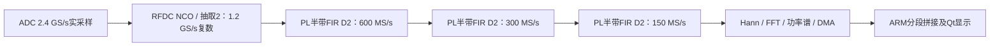

# 频率规划、带宽与测量范围

## 先区分五个量

| 量 | 当前值 / 含义 | 不能据此直接推出的指标 |
|---|---|---|
| 中频工作频段 | 1.3–2.3 GHz，跨度1 GHz | 不等于已实测全带平坦度或所有频点功率精度 |
| ADC / DAC物理采样率 | 均2.4 GS/s | 不等于可直接给ARM传送的原始数据率 |
| TX复数I/Q接口 | 1.2 GS/s；每拍4对I/Q，300 MHz | 不能忽略RFDC插值滤波通带 |
| 最终RX复采样率 | 150 MS/s，复频率网格为中心±75 MHz | 两端不是150 MHz平坦模拟通带 |
| RX全带扫描 | 13段NCO调谐、重叠拼接成1300–2300 MHz | 不是1 GHz同时采集或无遗漏瞬态监测 |

## 1.3–2.3 GHz为什么可用于2.4 GS/s带通采样

目标是处理1 GHz宽的中频工作带。设下、上边界为`fL=1.3 GHz`、`fH=2.3 GHz`，带宽`B=1 GHz`。实数采样`Fs=2.4 GS/s`的第二奈奎斯特区间是1.2–2.4 GHz，目标带两侧各保留100 MHz到区界的距离。

带通采样在第2区的无自混叠速率条件为 `2 fH / 2 <= Fs <= 2 fL / (2-1)`，本例即`2.3 <= Fs <= 2.6 GS/s`，所选2.4 GS/s位于其中。该计算解释了工作带选择，而不是随机指定两个端点。[Analog Devices带限采样说明](https://www.analog.com/en/resources/technical-articles/basics-of-bandlimited-sampling-and-aliasing.html)介绍了带限与混叠条件；[高速ADC说明](https://www.analog.com/en/resources/technical-articles/understanding-ac-behaviors-of-high-speed-adcs.html)说明奈奎斯特区间及实际滤波保护带。

第二区频谱折叠后有频率反转：`f_alias = Fs - f_RF`。

| 输入RF | 采样后的第一奈奎斯特区映射 |
|---|---|
| 1.300 GHz | 1.100 GHz |
| 1.800 GHz | 0.600 GHz |
| 2.300 GHz | 0.100 GHz |

数字混频利用NCO将选中频带搬到复基带，再抽取降低处理速率。实际输入必须带限或来自已知洁净中频源；区外信号混叠进来后，ADC后的FIR不能将其恢复成不同的原始射频频率。当前平台没有已验收的宽覆盖射频预选/外部变频前端。

## TX：宽带矢量架构与插值滤波的边界

冻结工程配置单路DAC 2.4 GS/s、复I/Q输入、2倍插值、细混频、NCO 1.8 GHz。I/Q是两路实分量，所以接口可写为`1.2 Gcomplex/s × 2分量 × 16 bit = 38.4 Gbit/s = 4.8 GB/s`；300 MHz下每拍4对I/Q。ADC前级与DAC数字接口均按宽中频架构设计，数字波形文件可包含多个频率分量，硬件播放不局限于一个单音。

**1.3–2.3 GHz是1 GHz宽的工作频段/设计目标；当前配置不能直接宣称已保证1 GHz平坦瞬时调制带宽。** AMD PG269给出的Gen1/Gen2 RF-DAC 2倍插值滤波器Nyquist通带比例为80%。按本工程1.2 GS/s复输入推导，规格内复通带总宽约`0.8 × 1.2 GHz = 960 MHz`，即复偏移约±480 MHz；固定1.8 GHz NCO时约对应1.32–2.28 GHz。此处是数字滤波规格推导，不是对模拟RF平坦度的实测结论。[AMD插值滤波器规格](https://docs.amd.com/r/en-US/pg269-rf-data-converter/RF-DAC-Interpolation-Filters-Gen-1/Gen-2)、[接口速率](https://docs.amd.com/r/en-US/pg269-rf-data-converter/RF-DAC-Interface-Data-and-Clock-Rates)。

这不等于1.3或2.3 GHz不能设置/产生CW，而是全带矢量波形的边缘幅频响应需要单独测量、评估。当前C++生成器允许数字RF设定1300–2300 MHz，沿用已测的`f_RF ≈ 1800 MHz − f_IQ`方向；1790 MHz只是CW功率模型的参考频点。内置LFM目前上限40 MHz，QAM/PSK符号率上限10 MSym/s；任意I/Q播放接口也受采样率、镜像、峰值、存储与通带约束。

若后续要求严格覆盖全1 GHz平坦调制通带，需要测量RFDC与模拟链路响应，评估采样率/滤波配置及预均衡。例如在相同80%数字比例下，1 GHz对应至少1.25 GS/s复输入、2.5 GS/s DAC；这只是设计算例，会涉及时钟、PL时序、DDR/DMA和接口契约重新验证。本次没有调整这些配置。单路DAC复混频也不能随意绕过插值：AMD说明此模式至少需要2倍插值。[AMD滤波器使用条件](https://docs.amd.com/r/en-US/pg269-rf-data-converter/Interpolation-Filter-Use)。

## RX：为什么150 MS/s与1 GHz覆盖可以同时成立

三级FIR合计抽取8，总抽取为16，最终复采样率`2.4 GHz / 2 / 8 = 150 MHz`。冻结系数分别15、23、63抽头。用仓库系数计算的理想、DC归一化级联响应如下（不含RFDC、量化及模拟链路）：

| 复频率偏移 | 级联FIR相对DC增益 |
|---|---|
| 50 MHz | 约+0.0008 dB |
| 60 MHz | 约+0.0006 dB |
| 70 MHz | 约−1.2445 dB |
| 75 MHz | 约−6.0229 dB |

所以150 MS/s是采样率，不能写成150 MHz全宽平坦通带。当前扫描取中心±50 MHz的100 MHz窗口，最大80 MHz步进，重叠至少20 MHz，再在ARM按真实频率网格拼接。1300–2300 MHz全跨度需要13段，中心依次为1340、1420、1500、1580、1660、1740、1820、1900、1980、2060、2140、2220、2260 MHz。NCO调谐保留目标附近的窄带信号，降低每次处理量，以顺序扫描换取1 GHz覆盖。

本质取舍是：**宽中频输入与可调谐覆盖 + FPGA窄带高速处理 + ARM仪器化显示**。宽扫描适合稳定或重复信号；仅出现一次的短瞬态可能发生在未驻留子带，不能宣称1 GHz实时无遗漏捕获。

## 操作与测量范围

| 功能 | 当前范围与边界 |
|---|---|
| RX频率覆盖 | 1300–2300 MHz；NCO调谐/顺序扫描 |
| RX显示跨度 | 0.01–1000 MHz；窄显示裁剪不自动改善底层RBW |
| FFT | 1024 / 8192 / 65536点；150 MS/s下Hann ENBW约219.727 / 27.466 / 3.433 kHz |
| Marker | M1–M4、峰值搜索、点击定位、参考Marker、频率差和幅度差 |
| 等效VBW | 线性功率多帧平均，最多256帧；不等同连续时间3 dB视频滤波器 |
| Sweep Time | 手动最小采集停留预算用于Live、Span>150 MHz分段扫描；窄带/流显示使用Auto，实际整轮耗时另显示 |
| CW输出频率 | Digital peak模式可设1300–2300 MHz，端点响应及全带幅度需按实物复核 |
| TX绝对功率 | V17允许1300–2300 MHz CW，1790 MHz以外标为ESTIMATED；4025G条件保留−40至−20 dBm；独立修正检查点−25 dBm读数−25.01/−25.01/−25.00 dBm，不能外推到所有频率、调制或全量程精度 |
| RX绝对功率 | 1790 MHz CW模型有效输入约−50.68至−30.73 dBm；独立点沿用原条件验收，全带谱线dBFS/bin不自动等于dBm |

已有端点、频率和功率读数见[实板记录](../board/measurements.md)、[标定数据](../data/calibration)。输入最大安全电平由XM500/ADC模拟接口决定，不能由本表的数字量程推导。

## 可以离线复核的部分

在仓库根目录运行 `python3 sim/check_bandplan.py`。脚本只读源码与系数，交叉核对采样率、滤波级数、GUI生成边界、13段覆盖及带宽计算；[已保存结果](../data/bandplan/offline_check.json)含输入文件SHA256。它不替代全带RF平坦度、杂散、调制质量或带外抑制测量。
