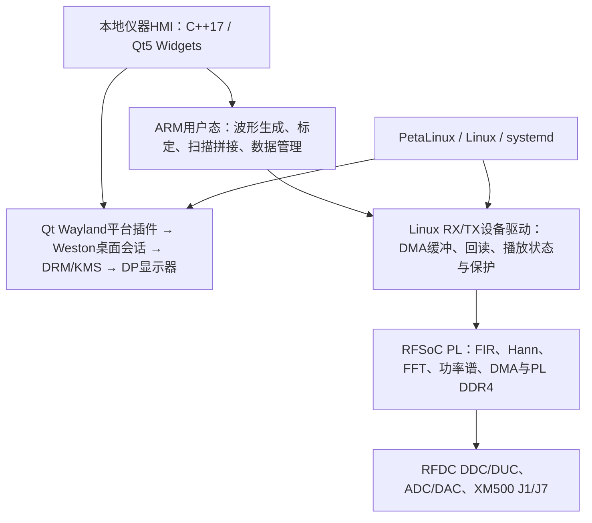

# 基于嵌入式Linux的RFSoC独立仪器

平台是一套**面向1 GHz级中频工作带的可编程I/Q矢量信号源与频谱分析系统**。高速信号链位于RFSoC可编程逻辑和片内ADC/DAC；ARM处理器独立运行PetaLinux、设备驱动、桌面会话和仪器应用。连接DP显示器与USB鼠标后，日常信号生成、上传校验、播放、采集、扫描及Marker操作均在板上完成。

## 完整软件栈

这里的Qt是原生C++仪器应用，Linux提供进程、存储与驱动管理，Weston提供Wayland桌面合成和输入事件，DRM/KMS驱动显示输出。显示配置沿用1080p/Pixman；V17上板验证通过由队伍确认，本次仓库交付对应源码。它不是依赖上位机运行的PyQt页面，也不要求板端Python或PYNQ。

这是成熟的嵌入式Linux仪器HMI技术路线：Qt负责控件与交互，内核驱动管理硬件资源，耗时工作交给后台任务。采用Qt本身不代表测量精度认证；规范性来自分层接口、默认停播、校验、错误处理与可复现构建。Qt官方说明了[嵌入式Linux的Wayland部署方式](https://doc.qt.io/qt-6/embedded-linux.html)，也介绍了[基于Qt的测量设备界面案例](https://www.qt.io/blog/kdab-qt-world-summit-and-kdab-training-day)；这些说明技术选型，本项目实际冻结版本仍是Qt5.15.13。

## 可编程矢量信号产生

矢量波形由复数序列 `I[n] + jQ[n]` 定义，包含随时间变化的幅度、相位和频率。播放硬件搬运相同格式的样点，并不需要为QAM、PSK或LFM分别搭建一套DAC硬件。ARM生成或导入兼容I/Q文件，经DMA存入PL DDR4，再按固定速率送RFDC插值、数字混频和DAC输出。

| 波形族 | V17原生C++内置 | 可调整的主要参数 | 现有外部证据 |
|---|---|---|---|
| CW连续波 | 是 | RF频率、数字幅度；全工作带CW dBm/dBW设置：1790 MHz参考，其他频点ESTIMATED | 功率与频率读数 |
| 脉冲 | 是 | 脉宽、重复周期、幅度、载频偏移 | 历史周期包络总览与放大图 |
| LFM / 脉冲LFM | 是 | 扫频带宽、周期；脉冲宽度 | 历史20 MHz LFM频谱及I/Q频率随时间分析 |
| Barker13相位编码 | 是 | 重复周期、幅度、偏移；当前码片固定1 µs | 生成实现与数字验证，独立RF验收待补 |
| PSK | 2 / 4 / 8阶 | 符号率、RRC滚降、偏移、幅度、种子 | 生成实现与数字验证，逐型RF验收待补 |
| QAM | 16 / 64 / 256阶 | 符号率、RRC滚降、偏移、幅度、种子 | 历史64QAM星座/EVM；当前C++16QAM频谱 |
| FSK、AM/FM及其他自定义调制 | 兼容I/Q文件扩展 | 由外部或扩展波形生成器定义 | 当前无内置FSK预设；附历史CPFSK2离线生成代码，见星座来源追溯 |

因此它是**以I/Q为统一接口、可扩展调制格式的矢量信号源**，并非只产生单音。“任意波形”表示在格式、采样率、存储、峰值和滤波通带约束内可描述的I/Q序列，不表示任意带宽、任意功率或所有制式已经完成射频认证。

当前本机生成契约为1.2 GS/s复采样、10 ms、I16/Q16小端交织，共1200万对I/Q、48 MB。内置LFM带宽上限40 MHz，PSK/QAM符号率上限10 MSym/s。上传与SHA256回读通过后仍保持停播；必须显式RF PLAY，支持RF STOP和播放保护。[实测图册](waveform_gallery.md)展示硬件输出，[带宽说明](bandplan_and_bandwidth.md)列出限制。

## 实现入口与源码对应

| 实现内容 | 当前源码 / 配置 |
|---|---|
| RFDC与ADC/DAC 2.4 GS/s、2倍抽取/插值 | [adc3_capture.tcl](../src/fpga/bd/adc3_capture.tcl) |
| 三级半带FIR抽取8 | [sa_d8_zoom.v](../src/fpga/rtl/sa_d8_zoom.v)、[系数目录](../src/fpga/coeff/sa) |
| Qt本机波形生成与I/Q文件 | [waveform.cpp](../src/linux/apps/instrument_cpp/src/waveform.cpp) |
| TX上传、校验和显式播放 | [tx.cpp](../src/linux/apps/instrument_cpp/src/tx.cpp)、[Linux源码目录](../src/linux) |
| 接收调谐与分段扫描 | [sweep.cpp](../src/linux/apps/instrument_cpp/src/sweep.cpp) |
| Qt / Wayland启动会话 | [run-wayland.sh](../board/runtime_layout/run-wayland.sh) |
| Weston / systemd / 1080p / Pixman | [显示配置](../board/runtime_layout/display-fix)、[apply-display-fix.sh](../board/runtime_layout/apply-display-fix.sh) |
| PetaLinux、SDK、驱动与应用构建 | [build/linux](../build/linux)、[完整复现](../build/reproduce.md) |

半带模块由sa_d8_zoom.v的d0/d1/d2实例接入DSP链路。本次修正了该模块一条过时的“尚未接入”注释；Verilog实现逻辑与narrow09硬件基线完全相同，身份检查会将这一处明确的注释替换还原后核对旧哈希。

## 为什么先做中频平台

项目先把1.3–2.3 GHz工作带的信号定义、DAC输出、ADC采集、数字处理、Linux控制和本地交互做成闭环，把外部射频前端留作可扩展模块。后级增加可调本振、混频器、滤波器和必要的幅度控制后，可把J7输出搬移到其他射频频段，向更广覆盖的完整信号源扩展。覆盖由模块本振范围、边带选择、滤波、镜像和输出电平共同决定，仍需整机标定；变频只搬移频带，不自动增加瞬时调制带宽。
