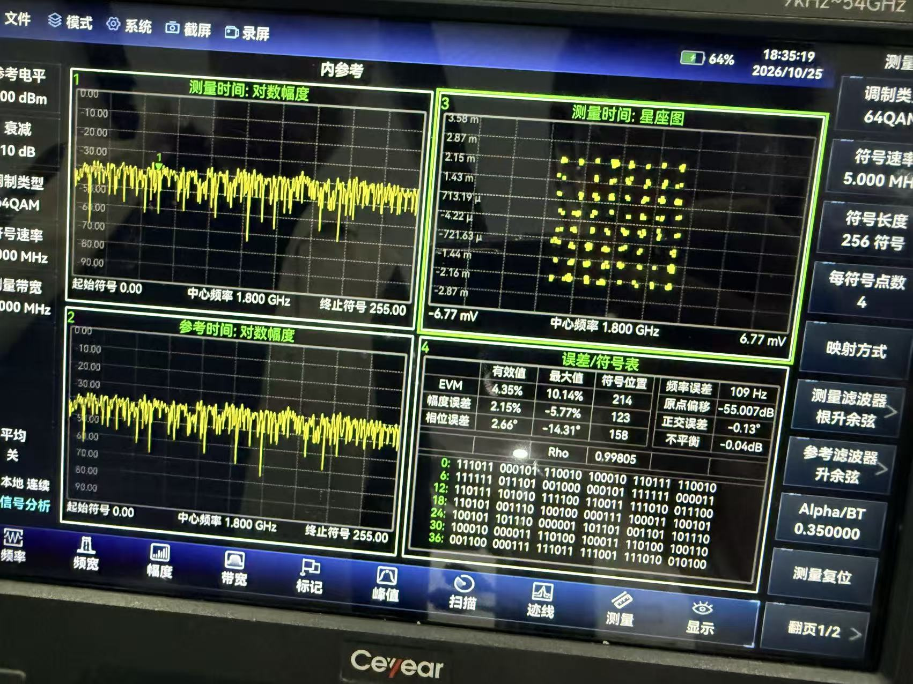
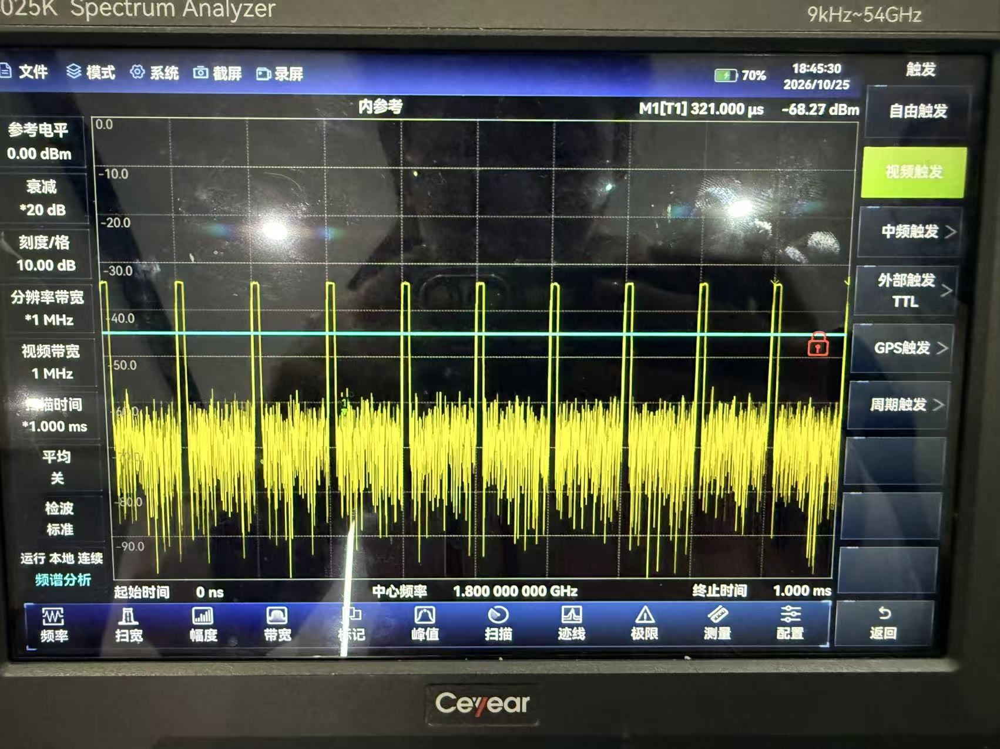
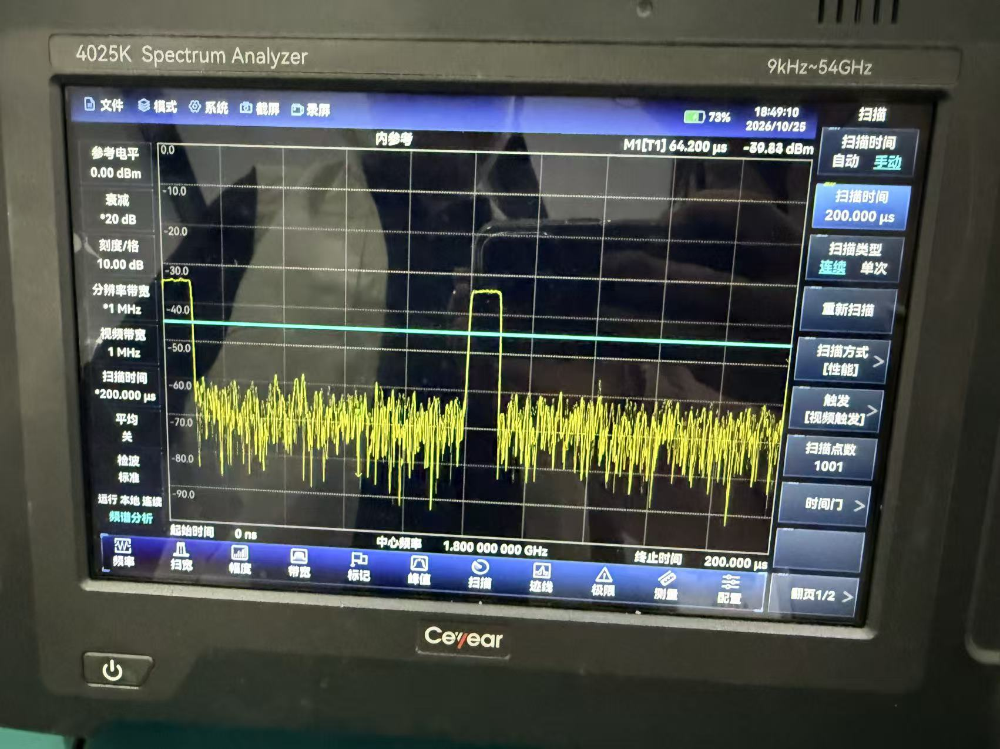
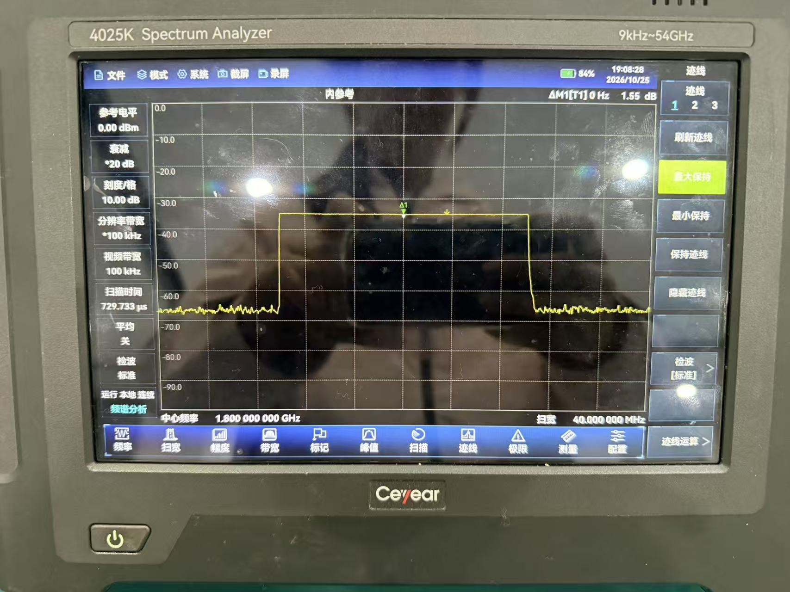
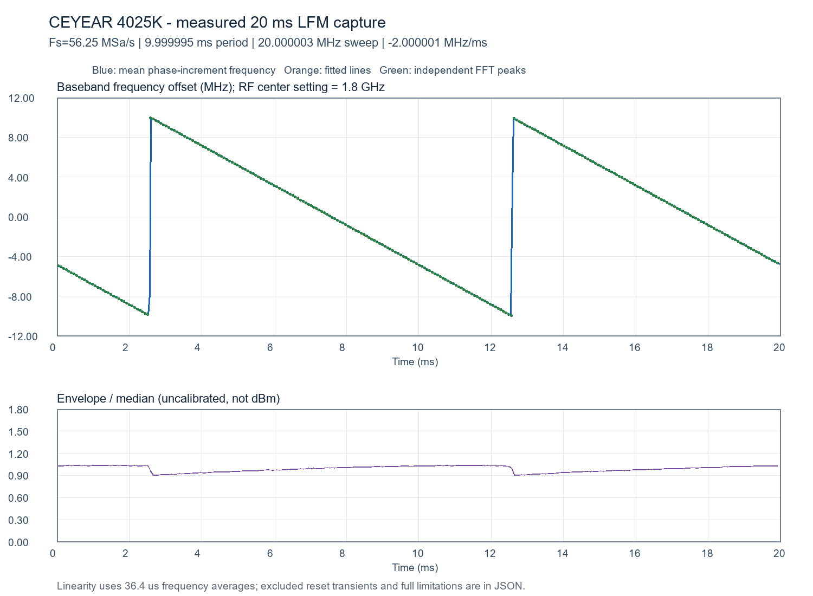
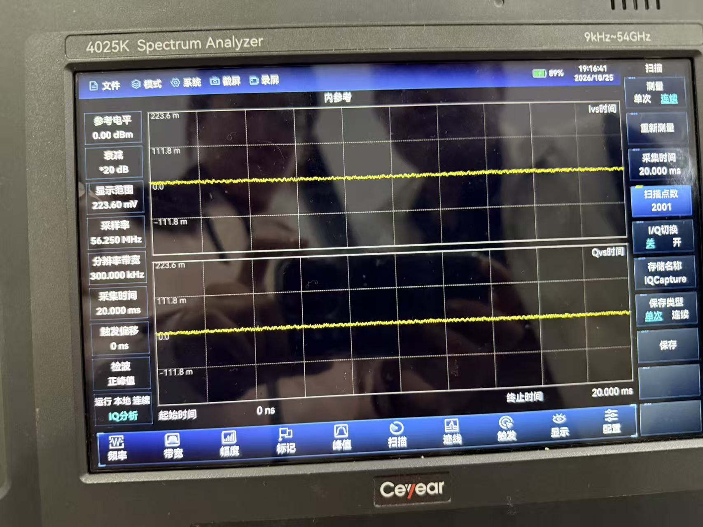

# 多种调制波形的外部测量图册

本平台以I/Q文件统一表达幅度、相位与频率变化，可产生CW、脉冲、LFM、相位编码、PSK与QAM，并扩展其他兼容I/Q调制。下列照片是2026-10-25在外部CEYEAR 4025K上的历史硬件输出观察，不是仿真图或AI生成图。这些历史实验由开发电脑预先生成I/Q，再上传当时的板卡版本播放；当前V17已在ZCU111的ARM端用原生C++生成内置波形，通过本地Qt界面操作，不依赖开发电脑或板端Python。照片展示矢量播放与模拟输出链路的阶段性结果；V17上板验证通过由队伍确认，历史照片保留原代码阶段与测量条件。

## 64QAM：可辨认的8×8星座

**图1：64QAM，中心1.8 GHz，5 MSym/s，RRC滚降0.35。** 照片可见8×8共64簇；256符号测量窗口中，仪器显示RMS EVM 4.35%、最大10.14%、频率误差109 Hz。测量仪器每符号4点不是本平台DAC接口的每拍4对I/Q。[原始转录与条件](../data/modulation/history_qam64_20261025/measurement.json)。

本图来自2026-10-25的Integrated TX v2（64 MiB、10 ms）版本。已找回原BIT/ELF、Vitis C源码及开发电脑上的历史Python生成器，并核对归档哈希；三个自写流通路RTL与当前版本字节相同。[完整追溯](constellation_code_trace.md)。

这张图可放首页“矢量信号产生”位置，也适合视频和材料的调制质量段落。它证明一次历史64QAM测量，不应标成16QAM，也不推导BER、长时EVM分布或当前V17逐型验收。此前中心设为1 GHz、EVM约40%的16QAM未锁定图不作为成功证据。

## 脉冲：周期包络与脉宽放大观察

**图2：1.8 GHz中心，零跨度时域观察，1 ms窗口。** 设定10 µs脉宽、100 µs周期（10 kHz PRF），屏幕约10次重复，便于展示稳定周期包络。图中Marker的321 µs是游标位置，不是脉宽。

**图3：同类脉冲的200 µs窗口放大。** 外观与10 µs脉宽、100 µs周期相符，历史人工检查已确认脉宽。两图的RBW/VBW均1 MHz，精确边沿和宽度误差仍受仪器响应影响；不凭照片填造上升时间、抖动或双Marker测量值。[参数记录](../data/modulation/history_pulse_20261025/measurement.json)。

首页建议使用图3，图2留在本页作为周期总览。1 ms或200 µs截图不单独证明完整10 ms模拟记录；10 ms文件长度来自波形样点数与采样率契约。

## LFM：最大保持覆盖与频率随时间验证

**图4：LFM约20 MHz频率覆盖，40 MHz显示跨度，RBW/VBW 100 kHz，最大保持开启。** 最大保持展示多次扫频经过的频率范围，本图本身不代表同一时刻所有频率同时存在，也不足以单独证明扫频线性。

**图5：历史实测I/Q的数值分析图，区别于仪器直接截图。** 20 ms记录、56.25 MS/s，共1125000对I/Q；含1个完整斜坡。已有分析估计周期9.999995 ms、带宽20.000003 MHz、在解码`I+jQ`约定下斜率−2.000001 MHz/ms，完整段分块平均频率拟合R²约0.99999995。[数值、原始输入SHA256及限制](../data/modulation/history_lfm_20261025/measurement.json)。

图4与图5一起用于LFM展示更完整：前者说明频率覆盖，后者说明频率随时间近似线性。正负斜率取决于I/Q约定；本图不声称完成绝对扫频方向、功率平坦度或全带1 GHz验收。原始9 MB仪器I/Q未随本仓库附带，JSON与图为既有分析产物，不应声称仅靠本页即可从原始样点重新计算全部结果。

## 补充：I/Q采集界面

**图6：测量方法与采集设置的辅助图。** 长时窗和较大的纵轴范围使I/Q看起来接近直线，不能据此判断调制是否成功。“2001”是显示扫描点，不能当成完整I/Q记录样点数；56.25 MS/s是外部仪器采集率，区别于本平台TX 1.2 GS/s和最终RX 150 MS/s。本图适合方法附页，不作为QAM星座或LFM线性度的主要证据。

## 展示与验证边界

- 首页：图1的64QAM星座、图3的脉冲包络、图4的LFM频谱；本页保留完整条件和图5数值分析。
- 演示视频：先拍板端Generator选择/生成/上传，再展示相应外部仪器图；历史照片标注日期，当前Qt录屏与历史硬件验收分开标注。
- 16QAM/64QAM是不同调制阶数，不互换图片标题；外部仪器能力也不写成板端已有解调/EVM分析功能。
- 对FSK及其他扩展调制，说明统一I/Q接口的可扩展能力；当前没有逐型外测证据的项目不填造照片或精度。

新补照片逐文件SHA256与原文件名见[照片索引](../data/modulation/photo_index_20261103.json)。未改变任何照片上的读数，也未用生成图替代测量照片。
