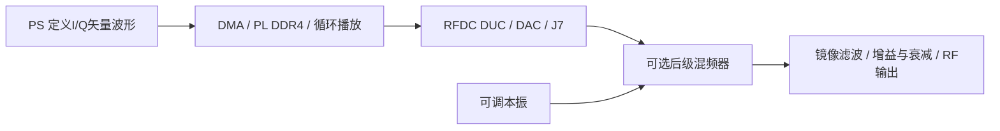

# 可编程矢量信号源与射频频段扩展

平台的发射核心是可编程复基带 I/Q 波形，经 DDR4 循环播放和 RF-DAC 数字上变频形成模拟射频输出。当前V17由板端ARM上的原生C++生成内置波形，本地Qt界面完成参数设置与控制；Python仅用于开发电脑上的参考验证和早期离线工具。CW 是这套矢量信号源的一个最简单的波形，1790 MHz 是功率测试示例和模型参考频点。

## 载频与功率是两个不同的设置

V17 / 0.11.0 的 Generator 在 Digital peak 模式下提供 RF 1300–2300 MHz 设置，内部按实测方向使用 f_IQ = 1800 MHz − f_RF。10 ms 循环记录要求频偏与记录周期相干。此处说明软件频率范围；全带端点幅度、镜像和调制质量不能只凭设置范围认定已验收。

V17的CW model dBm/dBW允许RF 1300–2300 MHz：1790 MHz使用指定线缆、参考面下的原参考模型，其他频点显式推广并标为ESTIMATED。保留4025G条件−40至−20 dBm、原FSVA条件−50至−10 dBm；全带频响修正和绝对功率精度未验收。

2026-11-03仓库已将V17作为当前生产源码入口；上板验证通过由队伍确认，本次按用户要求提供源码。旧V16测量保留为历史证据，详见[版本说明](../docs/v17_release.md)。

## 波形能力和验证层次

| 类型 | 当前入口 | 可以据此说明的能力 |
|---|---|---|
| CW、脉冲 | C++ Qt内置 | 10 ms I/Q产生、DDR4校验播放；已有CW和历史脉冲RF记录 |
| LFM、脉冲LFM | C++ Qt内置 | 可设扫频参数；历史LFM有外部IQ分析，具体版本见原记录 |
| Barker13相位编码 | C++ Qt内置 | 固定1 μs码片、13码片，PRI/幅度可设 |
| 2/4/8PSK | C++ Qt内置 | 阶数、符号率和RRC成形参数可设 |
| 16/64/256QAM | C++ Qt内置 | 阶数、符号率、RRC成形；当前C++16QAM有RF频谱，历史64QAM有星座照片 |
| FSK、AM/FM及其他自定义调制 | 定义并导入符合契约的I/Q文件 | 播放链路不依赖调制名称；当前没有FSK内置按钮，不宣称本轮已完成FSK RF测试 |

“任意波形”是指在采样率、量化、记录长度、模拟链路带宽和峰值余量约束内，自定义兼容I/Q记录；并不表示不受带宽限制，或每一种调制已逐一完成射频验收。调制信号的带内总功率、PAPR与CW峰值不同，CW补偿不能直接当作所有调制的平均功率标定。

I/Q记录契约：1.2 G复点/s，10 ms为12,000,000对样本、48,000,000字节，little-endian signed int16交织I0 Q0 I1 Q1；4对复样本组成一拍。频率方向为RF约1800 MHz减IQ频率。上传必须遵守现有元数据、长度、峰值、SHA256与回读检查，默认停播并由用户显式RF PLAY。详见src/linux/apps/instrument_cpp中的波形生成和TX接口实现。板上运行原生C++，不依赖Python或PYNQ。

## 历史星座的正确使用

2026-10-25 的 CEYEAR 4025K 原始照片可见64QAM的8×8簇，中心1800 MHz、5 MSym/s、RRC α=0.35、256符号测量窗口，屏显RMS EVM 4.35%、最大10.14%。见[data/modulation/history_qam64_20261025](../data/modulation/history_qam64_20261025)。它证明当时I/Q播放及模拟发射链路具有矢量调制能力；不能替代当前V17 C++生成器的完整RF EVM/BER验收，也不等于长时间EVM分布。

本次补交的16QAM照片中心为1.000 GHz、RMS EVM 39.99%，没有分辨出16簇，属于未对准分析中心的调试画面。不能将它放在“16QAM合格星座”位置。历史对话另有中心1.8 GHz、EVM约3.67%的反馈，但本次未找到对应原始照片，因此不以该数值充当新的图像证据。

## 后级变频扩展

通过选择本振与上下边带，可把本机输出平移到其他射频频段，典型关系为f_out = |f_LO ± f_J7|。模块本振范围、混频器RF/IF带宽、滤波器、增益平坦度和镜像抑制决定实际覆盖。它扩展射频调谐覆盖，瞬时调制带宽仍由I/Q、DAC、滤波与变频链共同限制。当前没有集成后级模块，不填写未经验证的完整频段或功率指标；接入后须重新做频率、幅度、杂散与调制质量标定。
